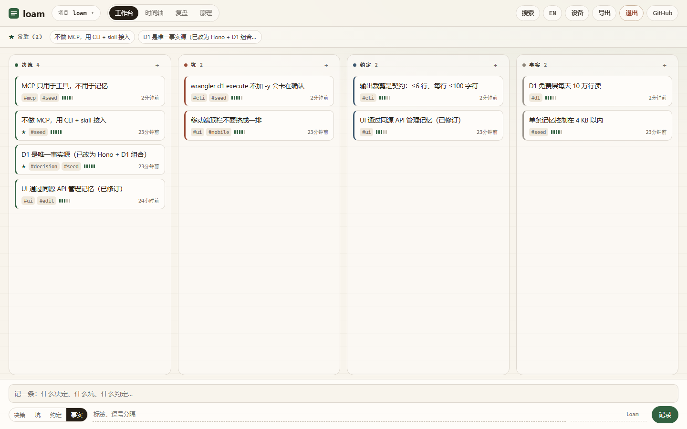
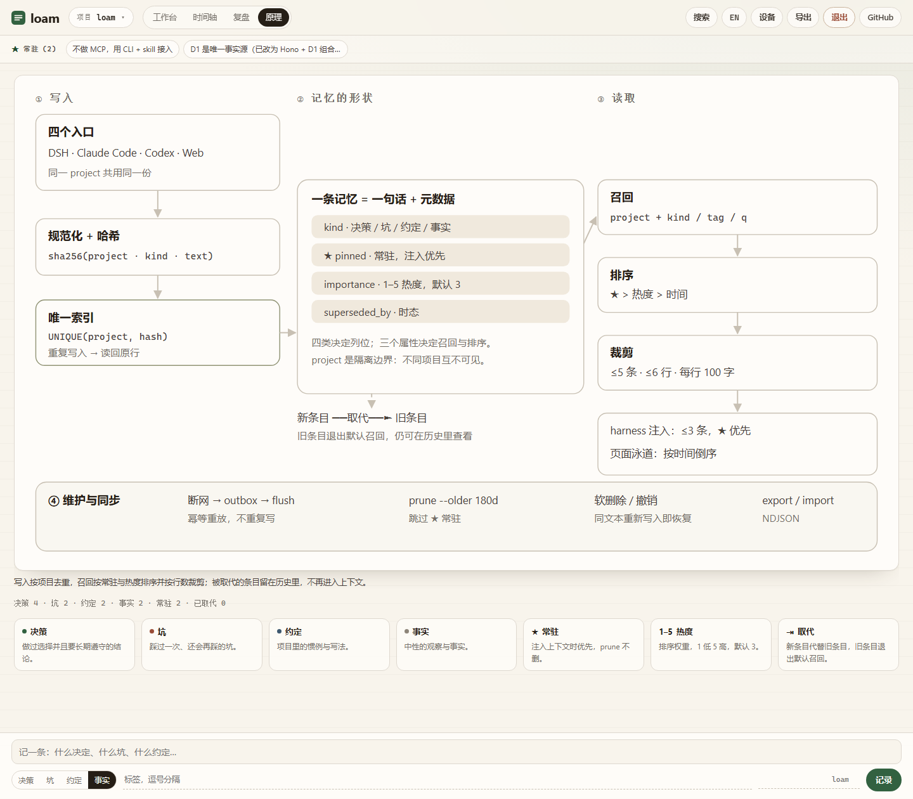

# loam

[简体中文](README.md) · **English**

Project-level long-term memory shared by one person across devices and harnesses (DSH / Claude Code / Codex).
One command to wire it up, CLI + skill to use it, Cloudflare free tier to host it, no MCP. The repo also ships a same-origin **memory workbench** (four lanes, model diagram, bilingual UI).

- Command: `loam`　Package: `@yidasanqian/loam`
- Backend: Workers + D1 (Hono routes, per-device Bearer, native rate limiting)
- Boundaries: [docs/SCOPE.md](docs/SCOPE.md) and [docs/DECISIONS/](docs/DECISIONS/)

## Why

Every harness keeps its own session memory, so project context does not cross devices. loam turns "decision / pitfall / convention / fact" into one line of text plus metadata, isolated by project, idempotent by hash, and authenticated per device. Write on one machine, and `loam search` hits it from the other before the next task starts.

```
harness (DSH / Claude Code / Codex)
   │  AGENTS.md marker block + SKILL.md
   ▼
loam CLI ──HTTPS/JSON──► Worker (Hono) ──► D1 (devices, facts)
   │                         └─ ratelimits binding
   ├─ ~/.loamrc.json        0600, server + device token
   ├─ ~/.loam/outbox.jsonl  offline writes
   ├─ ~/.loam/cache/        5-minute read cache
   └─ ~/.loam/install.json  install manifest for doctor / uninstall
```

## Memory model

Four kinds say what a fact is; three attributes say whether it still counts and how high it ranks:

| Dimension | Values | Purpose |
|---|---|---|
| `kind` | decision / pitfall / convention / fact | the four lanes in the UI; recall semantics |
| `pinned` | 0/1 | core memory: injected first, reviewed first, never pruned |
| `importance` | 1..5 (default 3) | rank weight, supplied by the writer |
| `superseded_by` | id of a newer fact in the same project | fact-level state: the old row leaves recall but stays in history |

- `sort=rank`: `pinned DESC, importance DESC, created_at DESC`, top-N only; paging stays on the `created_at` keyset.
- Superseding is only created through `POST {supersedes}`; PATCH can only clear it, so chains cannot form cycles.
- The "Model" view draws this path and maps every box to code (see [docs/UI.md](docs/UI.md)).

## Quick start (local)

```bash
pnpm install
cd worker
cp .dev.vars.example .dev.vars            # set ADMIN_TOKEN
pnpm dlx wrangler d1 execute loam --local --file=./schema.sql   # fresh database
# an existing 0.1 database runs only the migration (not schema.sql):
# pnpm dlx wrangler d1 execute loam --local --file=./migrations/0002-memory-shape.sql
pnpm dev                                   # http://127.0.0.1:8787

# another terminal
cd ../cli
pnpm build
LOAM_ADMIN_TOKEN=... node dist/bin.js login --server http://127.0.0.1:8787 --name win-desktop
node dist/bin.js add "D1 is the source of truth" --kind decision --importance 5
node dist/bin.js add "Use Hono plus D1" --kind decision --supersedes <old id>
node dist/bin.js search "source"
```

## Deploy (Cloudflare)

```bash
cd worker
pnpm dlx wrangler d1 create loam           # then fill database_id in wrangler.toml
# pick one: fresh database runs schema.sql; an existing 0.1 database runs only the migration.
pnpm dlx wrangler d1 execute loam --file=./schema.sql --remote
# pnpm dlx wrangler d1 execute loam --file=./migrations/0002-memory-shape.sql --remote
pnpm dlx wrangler secret put ADMIN_TOKEN   # only used by /v1/activate
pnpm deploy
```

The `deploy` workflow only **verifies** the schema (it fails on a missing column) and never alters the database; run the migration above first. Back up before upgrading with `loam export --out backup.ndjson` or `wrangler d1 export loam --remote --output backup.sql`.

Reference deployment: `https://loam.sanqian.workers.dev`. `ADMIN_TOKEN` only issues device tokens; each device then authenticates with its own `loam_<id8>_<32B>` token, and revoking one device does not touch the others.

Run `loam export --out backup.ndjson` before upgrading. The new columns are purely additive; old code ignores them, so rolling the code back does not require a schema rollback.

The `deploy` workflow verifies the schema and refuses to deploy when a column is missing; it never migrates. Apply `worker/migrations/0002-memory-shape.sql --remote` first, then push or dispatch the deploy workflow.

Direct access to `workers.dev` from mainland China may time out (a proxy is usually required). Store the proxy once at login, and Node ≥24 picks it up automatically:

```bash
loam login --server https://loam.sanqian.workers.dev --name win-desktop --proxy http://127.0.0.1:7890
loam search "keyword"
```

## Wire up three harnesses

```bash
loam install              # detects ~/.dsh, ~/.claude, ~/.codex and asks
loam install --only codex --dry-run
loam install --with-hooks # opt-in Claude Code UserPromptSubmit hook
loam doctor               # token / skill / marker block / last recall
loam uninstall            # exact rollback from install.json
```

`install` touches only two things: the `<!-- loam:start -->…<!-- loam:end -->` block in the repo `AGENTS.md`, and each harness's instruction file plus skill directory. Every write is recorded in `~/.loam/install.json`.

Upgrading the CLI does not refresh that copy; re-run install afterwards:

```bash
loam upgrade        # CLI / npm latest / installed skill version
npm i -g @yidasanqian/loam@latest
loam install        # refresh the skill and the AGENTS block
loam doctor         # the version check reports wiring drift
```

## CLI

| Command | Purpose |
|---|---|
| `login --server URL --name NAME` | register or rotate this device's token into `~/.loamrc.json` |
| `add "<text>" --kind … --importance 1..5 [--pin] [--supersedes id]` | record a fact; idempotent on `project + kind + text` |
| `search "<keywords>" [--sort rank\|recent]` | 5 results, ≤6 lines, ≤100 chars each; ranked by default |
| `show <id\|prefix>` / `list` | one fact with pinned/supersede state / recent facts |
| `devices [list\|revoke\|rotate]` | device and token lifecycle |
| `upgrade` | compare the CLI with npm and with the installed skill version |
| `export` / `import` | NDJSON backup and restore (includes pinned/importance) |
| `flush` | replay the offline outbox |
| `prune --older 180d` | soft-delete stale facts (skips pinned) |

Full flags, exit codes and environment variables: [docs/CLI.md](docs/CLI.md).

## Memory workbench

Open `https://loam.sanqian.workers.dev/` after deploying and paste the token from `~/.loamrc.json`:

- **Board**: decision / pitfall / convention / fact as four independently scrolling lanes; the page itself never scrolls. Drag a card to another lane to reclassify it.
- **Inspector**: full text, provenance, pin, importance 1–5, supersede state, edit and delete (6-second undo) without losing your place.
- **Capture**: a dock at the bottom, project inherited from the current one; "Mark outdated" prefills `supersedes`.
- **Timeline**: today / last 7 days / last 30 days / older, side by side.
- **Review**: one card at a time — reclassify, pin, edit, delete, skip.
- **Model**: a working-principle diagram of the memory model (write → shape → recall → upkeep), mapped to code, with live counts.
- **Bilingual**: the UI follows the browser language (`localStorage` → `navigator.languages` → `en`) and can be switched in the top bar.

<details>
<summary>Screenshots (3, click to expand)</summary>

**Workbench · 1440×900**



**Memory model diagram · 1440×900**



**Mobile · 390×844**


</details>

The page is served from Workers Assets (`worker/public/`) and calls `/v1/*` same-origin. The token stays in this browser's localStorage; CSP forbids inline scripts/styles and external resources. No build step, no framework, no third-party frontend dependency.

## Development and verification

```bash
pnpm typecheck
pnpm -r test                     # worker: vitest official pool; cli: node:test
pnpm --filter @loam/worker test:offline   # dependency-free: real SQL on node:sqlite
pnpm check:licenses              # license allowlist
```

The offline suite does not need workerd: `worker/test/offline` implements a D1-shaped adapter on `node:sqlite` and runs the real schema, idempotency, supersede, rank and soft-delete paths.

The 10-item manual UI checklist is in [docs/UI.md](docs/UI.md); `scripts/seed-dev.mjs` seeds local sample data.

## Status

| Stage | State |
|---|---|
| M0 skeleton + boundaries + ADRs | done |
| M1 Worker + auth + facts CRUD + rate limits | done; HTTP 23/23 |
| M2 CLI MVP + outbox + output clipping | done; CLI 32/32 |
| M2.5 installer + doctor + uninstall | done |
| M3 three harnesses / M4 second machine | all three harnesses hit in headless sessions; second physical machine not tested |
| M5 CI / license / publish | `0.1.0`, `0.1.1`, `0.1.2` published; CI, auto-deploy and migration guard green |
| Workbench + memory shape (ADR-0006) | released in `0.1.2`; offline 17/17, HTTP 23/23, CLI 38/38 |

## GitHub CI/CD

- `push` / PR → `ci`: typecheck, Worker HTTP, CLI, offline, licenses, `wrangler deploy --dry-run`
- `push main` (`worker/**`) → `deploy`: D1 schema → `wrangler deploy` → `/health` smoke; gated by the `CF_DEPLOY=true` repository variable
- `tag v*` → `release`: full tests → `pnpm build` → `npm publish --provenance --access public`

Enable auto-deploy once:

```bash
gh variable set CF_DEPLOY --body true
gh secret set CLOUDFLARE_ACCOUNT_ID --body "56cf8c921cb267fdae6d1f401bff12e2"
gh secret set CLOUDFLARE_API_TOKEN      # Workers Scripts:Edit + D1:Edit
```

Publishing uses **Trusted Publishing (OIDC)** only: no `NPM_TOKEN`, no manual `npm publish` step. Push a tag → the `release` workflow publishes to npm.

Then configure `npmjs.com/package/@yidasanqian/loam/settings → Trusted Publisher → GitHub Actions`:

| Field | Value |
|---|---|
| Organization or user | `yidasanqian` |
| Repository | `loam` |
| Workflow filename | `release.yml` |
| Environment | empty |

After that, pushing a tag publishes with provenance from OIDC:

```bash
git tag v0.1.0 && git push --tags
```

> If a tag release fails at `npm publish` with `404 Not Found - PUT https://registry.npmjs.org/@yidasanqian%2floam`, the npm-side Trusted Publisher is missing or does not match this repo/workflow; it is not a code problem. Configure `release.yml` under the package settings and tag a new version; do not publish with a token.
>
> `--provenance` only supports public source repositories. This repo is now public, so tag releases publish with provenance. `0.1.1` / `0.1.2` predate this configuration and carry no provenance; if the repo becomes private again, the workflow drops provenance automatically.

`deploy` is serialized with `concurrency`; `release` relies on npm provenance (`id-token: write`).

## Docs

- [docs/SCOPE.md](docs/SCOPE.md) capabilities and quantified boundaries
- [docs/ARCHITECTURE.md](docs/ARCHITECTURE.md) components, data flow, storage
- [docs/UI.md](docs/UI.md) workbench layout, diagram-to-code map, manual checklist
- [docs/AUTH.md](docs/AUTH.md) device tokens, revocation, rate limits
- [docs/CLI.md](docs/CLI.md) command reference
- [docs/INSTALL.md](docs/INSTALL.md) harness wiring and rollback
- [docs/DEPENDENCIES.md](docs/DEPENDENCIES.md) dependency and license policy
- [SECURITY.md](SECURITY.md) plaintext boundary and reporting

Apache-2.0. Original plan: [PLAN.md](PLAN.md).