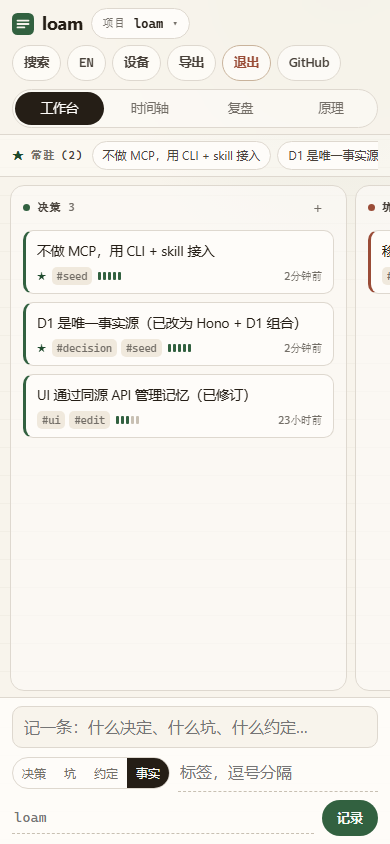

# loam

[简体中文](README.md) · **English**

[](https://www.npmjs.com/package/@yidasanqian/loam)
[](https://www.npmjs.com/package/@yidasanqian/loam)
[](https://github.com/yidasanqian/loam/actions/workflows/ci.yml)
[](LICENSE)
[](package.json)

**One project memory, shared by Claude Code / Codex / DSH.**
One line per fact, about 200 tokens injected; no MCP, no vector store, no auto-transcription. The backend runs on Cloudflare's free tier, or deploy it to your own account in one click.

```bash
npx @yidasanqian/loam onboard --server https://loam.example.workers.dev --name my-laptop
```

That logs this machine in, writes the harness conventions, and installs the skill. The first registration needs `ADMIN_TOKEN`:

```bash
LOAM_ADMIN_TOKEN=... npx @yidasanqian/loam onboard --server https://loam.example.workers.dev --name my-laptop
```

> `onboard` ships with 0.2. On npm 0.1.3, `loam install -y` plus `loam login --server … --name …` does the same.
> No backend yet? Use [one-click deploy](#option-a-one-click-deploy) below, then run this line.

```text
$ loam add "Bearer tokens are per-device" --kind decision --tags auth
+ 3f9c2a1e [decision] loam

$ loam search "auth token"
- [decision] Bearer tokens are per-device (claude · 2026-11-18 · 3f9c2a1e · 4/5)
```

> Example output. Recall returns 5 facts by default, ≤100 chars each; only the first 3 are injected into the harness.

**See it** [workbench](#memory-workbench) · **Deploy** [one-click](#option-a-one-click-deploy) / [CLI](#option-b-command-line) · **Docs** [docs/](docs/)

## Not another memory tool

- **Not an MCP server**: usage is a CLI + skill, no long-running process, no tool-slot cost; about 200 tokens per injection.
- **Not auto-transcription or a vector store**: you decide what is written, one line per fact; dedupe, supersede and ranking happen at write time, so recall is explainable.
- **Not a team collaboration platform**: single user, many devices; tokens are per device, revoking one leaves the others alone, and the data lives in your own D1.
- **Not tied to one harness**: the same memory is written and read by Claude Code, Codex and DSH.

## Start in three steps

1. **Get a backend**: click [one-click deploy](#option-a-one-click-deploy), or run `wrangler deploy` yourself as in [option B](#option-b-command-line).
2. **Wire the harnesses**: run `onboard` above; with an existing token it skips login and only refreshes the wiring.
3. **Use it**:

   ```bash
   loam search "keywords"
   loam add "D1 is the single source of truth" --kind decision --importance 4
   ```

Once wired, the harness runs `loam search` before a task and `loam add` when something is worth keeping. Self-check with `loam doctor`, roll back with `loam uninstall`, refresh only the skill with `npx skills update loam`.

## Compatibility

| Harness | Convention | Skill | Hook |
|---|---|---|---|
| Claude Code | `~/.claude/CLAUDE.md` marker block | linked by `npx skills add` into `~/.agents/skills` | optional `UserPromptSubmit` |
| Codex | `~/.codex/AGENTS.md` marker block | reads `~/.agents/skills` directly | — |
| DSH | `~/.dsh/AGENTS.md` marker block | reads `~/.agents/skills` directly | Cordis plugin (v1.1) |
| Other Skills CLI agents | manual reference | `npx skills add yidasanqian/loam` | — |

The repository's own `AGENTS.md` also receives the marker block, so project-level conventions travel with the repo.

## Memory workbench

Open your worker URL and paste the token from `~/.loamrc.json`:

- **Board**: decision / pitfall / convention / fact as four lanes; drag a card to reclassify it, the page never scrolls.
- **Inspector / Review**: full text, provenance, pin, importance, supersede chain; review one card at a time.
- **Timeline / Model**: four time buckets; a memory-model diagram mapped to code.
- Bilingual (zh / en), following the browser language.

**Workbench · 1440×900**


**Memory model diagram · 1440×1260**


**Mobile · 390×844**



The page is served from Workers Assets (`worker/public/`) and calls `/v1/*` same-origin. No build step, no framework, no third-party frontend dependency. The same page can be hosted on Cloudflare Pages (see [option C](#option-c-cloudflare-pages)).

## Self-hosting

Three methods; pick one. Full steps, limits and backups: [docs/DEPLOY.md](docs/DEPLOY.md).

### Option A: one-click deploy

[](https://deploy.workers.cloudflare.com/?url=https://github.com/yidasanqian/loam/tree/main/worker)

Click it: Cloudflare copies `worker/` into your GitHub account, creates the Worker and D1, prompts for `ADMIN_TOKEN`, runs the `deploy` script (schema, then deploy), and wires up Workers Builds. Afterwards you only bind a domain (optional) and run `loam login`.

### Option B: command line

```bash
cd worker
pnpm dlx wrangler d1 create loam
pnpm dlx wrangler d1 execute loam --file=./schema.sql --remote   # fresh database; existing ones run migrations/
pnpm dlx wrangler secret put ADMIN_TOKEN
pnpm run deploy
```

For an existing 0.1 database run only the migration; backups, rollback and proxy setup are in [docs/DEPLOY.md](docs/DEPLOY.md).

### Option C: Cloudflare Pages

The same Hono app runs on Pages Functions, with the workbench and the API on one `*.pages.dev` origin.

```bash
pnpm dlx wrangler d1 create loam          # skip if you already have the Worker database
pnpm dlx wrangler pages project create loam --production-branch main
pnpm dlx wrangler pages secret put ADMIN_TOKEN
pnpm pages:deploy                          # rebuilds pages/public, then uploads
```

Pages has no `ratelimits` binding, so rate limiting degrades to the single-isolate in-memory fallback; schema, migrations and limits: [docs/DEPLOY.md](docs/DEPLOY.md).

## For developers

```bash
pnpm install
pnpm typecheck && pnpm -r test
pnpm check:licenses
```

Local worker / CLI debugging, code conventions, CI and publishing: [CONTRIBUTING.md](CONTRIBUTING.md).
Architecture: [docs/ARCHITECTURE.md](docs/ARCHITECTURE.md); progress: [docs/STATUS.md](docs/STATUS.md).

## Docs

- [docs/DEPLOY.md](docs/DEPLOY.md) three deploy paths, migrations, backups, proxy
- [docs/INSTALL.md](docs/INSTALL.md) harness wiring and rollback
- [docs/CLI.md](docs/CLI.md) command reference
- [docs/ARCHITECTURE.md](docs/ARCHITECTURE.md) components, data flow, storage
- [docs/UI.md](docs/UI.md) workbench layout, diagram map, manual checklist
- [docs/AUTH.md](docs/AUTH.md) device tokens, revocation, rate limits
- [docs/SCOPE.md](docs/SCOPE.md) scope and quantified boundaries
- [docs/STATUS.md](docs/STATUS.md) milestones and released versions
- [CONTRIBUTING.md](CONTRIBUTING.md) development, tests, CI, publishing
- [SECURITY.md](SECURITY.md) plaintext boundary and reporting

If loam is useful to you, a star helps; questions and ideas go to [Issues](https://github.com/yidasanqian/loam/issues).

Apache-2.0. Original plan: [PLAN.md](PLAN.md).