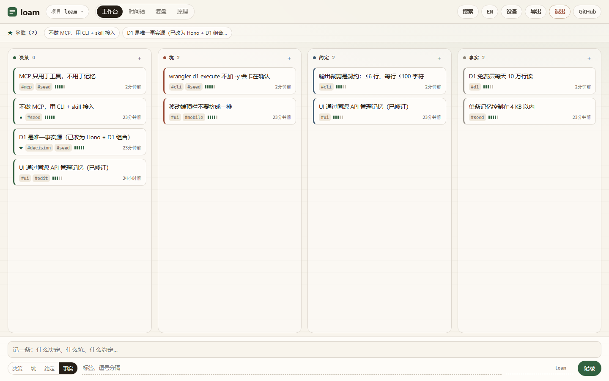
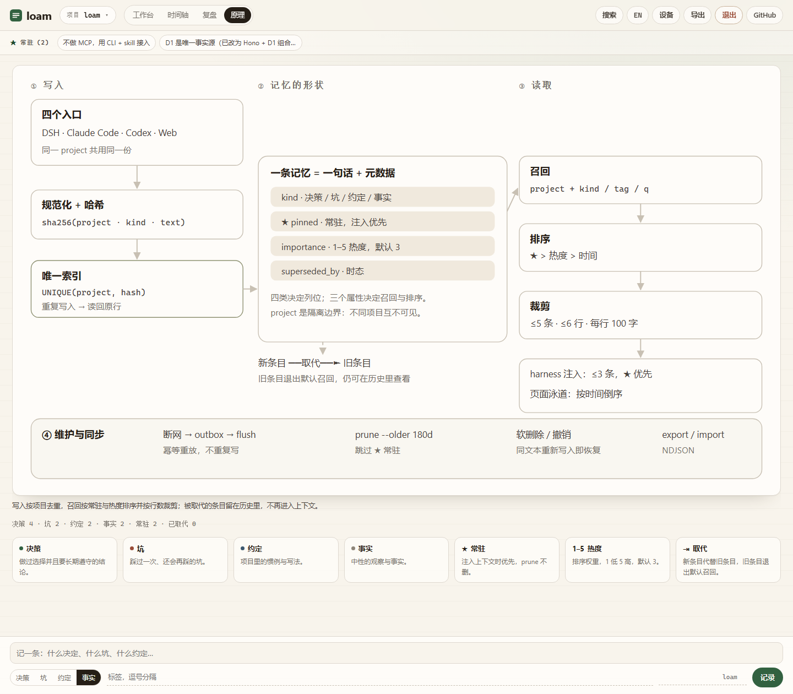
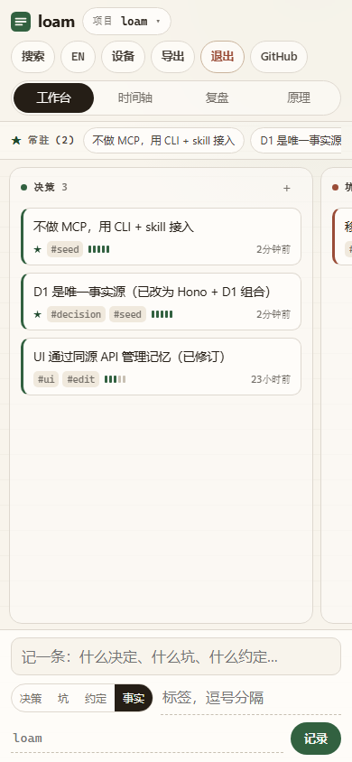

# loam

**简体中文** · [English](README.en.md)

[](https://www.npmjs.com/package/@yidasanqian/loam)
[](https://www.npmjs.com/package/@yidasanqian/loam)
[](https://github.com/yidasanqian/loam/actions/workflows/ci.yml)
[](LICENSE)
[](package.json)

**一份项目记忆，Claude Code / Codex / DSH 共用。**
一行文本一条事实，注入约 200 token；不装 MCP、不跑向量库、不做自动转录。后端跑在 Cloudflare 免费层，也可以一键部署到你自己的账号。

```bash
npx @yidasanqian/loam onboard --server https://loam.example.workers.dev --name 我的笔记本
```

一条命令完成登录、写各端调用约定、装 skill。首次注册需要 `ADMIN_TOKEN`：

```bash
LOAM_ADMIN_TOKEN=... npx @yidasanqian/loam onboard --server https://loam.example.workers.dev --name 我的笔记本
```

> `onboard` 自 0.2 起提供。npm 上还是 0.1.3 时，用 `loam install -y` + `loam login --server … --name …` 达到同样效果。
> 还没有后端？先看下面的[一键部署](#方式-a一键部署)，再回来跑这行。

```text
$ loam add "Bearer tokens are per-device" --kind decision --tags auth
+ 3f9c2a1e [decision] loam

$ loam search "auth token"
- [decision] Bearer tokens are per-device (claude · 2026-11-18 · 3f9c2a1e · 4/5)
```

> 示例输出。召回默认 5 条、每行 ≤100 字符；注入给 harness 的只有前 3 条。

**看界面**：[工作台](#记忆工作台) · **部署**：[一键](#方式-a一键部署) / [命令行](#方式-b命令行) · **文档**：[docs/](docs/)

## 不是又一个 memory 工具

- **不是 MCP server**：调用是一个 CLI + skill，不需要常驻进程，不占工具列表；每次注入约 200 token。
- **不是自动转录 / 向量库**：写什么由你决定，一行一条；去重、取代、排序在写入时确定，召回可解释。
- **不是团队协作平台**：单用户、多设备；token 按设备发，撤销一台不影响其它设备，数据在你自己的 D1 里。
- **不是只服务一个 harness**：同一份记忆，Claude Code、Codex、DSH 都能写、都能读。

## 三步开始

1. **有后端**：点[一键部署](#方式-a一键部署)，或按[命令行](#方式-b命令行)自己 `wrangler deploy`。
2. **接三端**：跑上面的 `onboard`；已有 token 时它会跳过登录，只刷新接线。
3. **用起来**：

   ```bash
   loam search "关键词"
   loam add "用 D1 作为唯一事实源" --kind decision --importance 4
   ```

接好之后不用记命令：harness 会在开工前 `loam search`、收尾时 `loam add`。自检 `loam doctor`，回滚 `loam uninstall`，只刷 skill 用 `npx skills update loam`。

## 支持范围

| harness | 调用约定 | skill | hook |
|---|---|---|---|
| Claude Code | `~/.claude/CLAUDE.md` 标记块 | `npx skills add` 链接到 `~/.agents/skills` | 可选 `UserPromptSubmit` |
| Codex | `~/.codex/AGENTS.md` 标记块 | 直接读 `~/.agents/skills` | — |
| DSH | `~/.dsh/AGENTS.md` 标记块 | 直接读 `~/.agents/skills` | Cordis 插件（v1.1） |
| 其它 Skills CLI agent | 手动引用 | `npx skills add yidasanqian/loam` | — |

仓库自己的 `AGENTS.md` 也会写入标记块，所以项目级约定跟着仓库走。

## 记忆工作台

打开你的 worker 地址，粘贴 `~/.loamrc.json` 里的 token：

- **工作台**：决策 / 坑 / 约定 / 事实四列，拖卡片即改类型，整页不滚动。
- **检视 / 复盘**：全文、来源、常驻、重要度、取代链；复盘一次一张。
- **时间轴 / 原理**：四段时间轴；一张与代码对应的记忆模型图。
- 界面中英双语，按浏览器语言切换。

**工作台 · 1440×900**



**记忆模型原理图 · 1440×900**



**移动端 · 390×844**



页面由 Workers Assets 托管（`worker/public/`），同源调用 `/v1/*`；无构建链、无框架、无第三方前端依赖。

## 自托管

两种方式，任选其一。完整步骤、限制与备份见 [docs/DEPLOY.md](docs/DEPLOY.md)。

### 方式 A：一键部署

[](https://deploy.workers.cloudflare.com/?url=https://github.com/yidasanqian/loam/tree/main/worker)

点按钮：Cloudflare 把 `worker/` 复制到你的 GitHub、创建 Worker 与 D1、提示填 `ADMIN_TOKEN`，然后按 `deploy` 脚本先建表再部署，并接上 Workers Builds。之后只需绑定域名（可选）并跑 `loam login`。

### 方式 B：命令行

```bash
cd worker
pnpm dlx wrangler d1 create loam
pnpm dlx wrangler d1 execute loam --file=./schema.sql --remote   # 全新库；已有库改跑 migrations/
pnpm dlx wrangler secret put ADMIN_TOKEN
pnpm run deploy
```

已有 0.1 的库只跑迁移；备份、回滚与代理设置见 [docs/DEPLOY.md](docs/DEPLOY.md)。

## 给开发者

```bash
pnpm install
pnpm typecheck && pnpm -r test
pnpm check:licenses
```

本地 worker / CLI 调试、代码约定、CI 与发布：[CONTRIBUTING.md](CONTRIBUTING.md)。
架构见 [docs/ARCHITECTURE.md](docs/ARCHITECTURE.md)，进度见 [docs/STATUS.md](docs/STATUS.md)。

## 文档

- [docs/DEPLOY.md](docs/DEPLOY.md) 两种部署方式、迁移、备份、代理
- [docs/INSTALL.md](docs/INSTALL.md) 三端接线与回滚
- [docs/CLI.md](docs/CLI.md) 命令参考
- [docs/ARCHITECTURE.md](docs/ARCHITECTURE.md) 组件、数据流、存储
- [docs/UI.md](docs/UI.md) 工作台版式、原理图映射、手测清单
- [docs/AUTH.md](docs/AUTH.md) 设备 token、撤销、限流
- [docs/SCOPE.md](docs/SCOPE.md) 范围与量化边界
- [docs/STATUS.md](docs/STATUS.md) 里程碑与已发布版本
- [CONTRIBUTING.md](CONTRIBUTING.md) 开发、测试、CI 与发布
- [SECURITY.md](SECURITY.md) 明文边界与报告方式

如果 loam 对你有用，给个 star；问题和想法走 [Issues](https://github.com/yidasanqian/loam/issues)。

Apache-2.0。计划原文见 [PLAN.md](PLAN.md)。